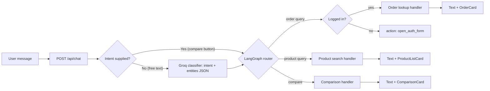

# 🛒 MERN E-Commerce Backend — with an AI Shopping Assistant

A REST API powering a full-featured e-commerce platform, built with **Node.js**, **Express**, and **MongoDB**. It handles authentication, products, orders, payments, image uploads, and an **AI chat assistant** (LangGraph + LangChain + Groq) that answers product questions, checks order status, and compares products.

🎬 [Watch the Video Walkthrough](https://youtu.be/gIIgdMW259Q) | 🌐 [Live Demo (Frontend)](https://mern-ecommerce-frontend-seven-sigma.vercel.app/) | 🖥️ [Frontend Repository](https://github.com/mHasan1037/mern-ecommerce-frontend)

> The API runs on free-tier hosting, so the first request after a period of inactivity can take up to a minute while the server wakes up.

---

## 📋 Table of Contents

- [Highlights](#highlights)
- [AI Shopping Assistant](#-ai-shopping-assistant)
- [Core Features](#-core-features)
- [Tech Stack](#tech-stack)
- [Architecture Notes](#architecture-notes)
- [Project Structure](#project-structure)
- [API Overview](#api-overview)
- [Getting Started](#getting-started)
- [Environment Variables](#environment-variables)
- [Available Scripts](#available-scripts)
- [Deployment](#deployment)
- [Author](#author)
- [License](#license)

---

## Highlights

- 🤖 **AI chat assistant** built with LangGraph, LangChain, and the Groq API: product search, order status, and product comparison, returned as typed card responses
- 🔐 **Cookie-based JWT authentication** (access + refresh tokens in httpOnly cookies) with Passport.js, email OTP verification, and password reset
- 💳 **Two payment options**: Cash on Delivery and online payment through SSLCommerz
- 🛍️ **Complete shopping backend**: products, categories, cart, wishlist, reviews, orders
- 📊 **Admin APIs**: dashboard stats, product and category management, order status workflow, low-stock alerts
- 🖼️ **Cloudinary** image uploads and cleanup
- 📄 **Server-side pagination, search, and filtering** across product and order lists

---

## 🤖 AI Shopping Assistant

The assistant is exposed through a single chat endpoint, `POST /api/chat`. A **Groq-based classifier** reads the user message and returns an **intent plus extracted entities as JSON**. A **LangGraph** workflow then routes the request to the matching handler.

| Intent                 | Example                                | What the API returns                                          |
|------------------------|----------------------------------------|---------------------------------------------------------------|
| **Product query**      | "Show me running shoes under 3000"     | Text reply plus a `ProductListCard`                           |
| **Order query**        | "Where is my last order?"              | Text reply plus an `OrderCard` (status, total, date, items)   |
| **Product comparison** | Two product IDs sent from the frontend | A `ComparisonCard` (price, category, rating, stock)           |

**Request flow**



- **Typed card responses.** Replies follow a discriminated-union pattern (`OrderCard | ProductListCard | ComparisonCard`) so the frontend can render each card type with its own component.
- **Auth-gated intents.** Order queries require a logged-in user. When the user is not authenticated, the API responds with an `open_auth_form` action instead of data, and the frontend opens its login modal and retries the original request after login.
- **Comparison bypasses the classifier.** The frontend's Compare button sends the comparison intent and product IDs directly, which skips classification for a faster and more reliable result.
- **Shared product search.** The product-query handler reuses the same `findProducts` logic as the regular products endpoint (regex match on name and description).
- **Groq in production.** The assistant originally ran on a local Ollama model (`ChatOllama`) and now uses `ChatGroq`, so it can be deployed on free-tier hosting.

---

## 🧩 Core Features

- **Authentication**: register with **email OTP verification**, login, logout, silent token refresh, forgot/reset password via emailed link, change password
- **Products**: CRUD, slug-based routing, search, category filter, price range, sorting, server-side pagination, featured products (write-time cap, read-time limit), most-sold products
- **Categories**: CRUD, custom ordering, and safe deletion: products are reassigned to another category before a category is removed
- **Reviews and ratings**: logged-in users can rate and review products
- **Cart and wishlist**: add, update, remove, and clear items
- **Orders**: create orders from the cart or a single product (Buy Now), order history, order details, status workflow `processing → shipped → delivered` (cancellation allowed before delivery; delivered and cancelled orders are locked)
- **Payments**: Cash on Delivery, or SSLCommerz with success, fail, and cancel callbacks
- **Admin**: dashboard totals (orders, users, revenue, products) with month-over-month growth, low-stock list, user insights (total spent, delivered/cancelled counts, latest order)
- **Emails**: OTP and password-reset emails via Nodemailer

---

## Tech Stack

| Category          | Technology                                             |
|-------------------|--------------------------------------------------------|
| Runtime           | Node.js                                                |
| Framework         | Express.js                                             |
| Database          | MongoDB (Atlas) + Mongoose                             |
| Authentication    | JWT (access + refresh tokens), Passport.js (`passport-jwt`), httpOnly cookies |
| Password Hashing  | bcryptjs                                               |
| **AI**            | LangGraph, LangChain, Groq API (`ChatGroq`)            |
| Image Hosting     | Cloudinary                                             |
| Payment Gateway   | SSLCommerz                                             |
| Email             | Nodemailer                                             |
| Slug Generation   | Slugify                                                |
| Dev Tool          | Nodemon                                                |
| Module System     | ES Modules (`"type": "module"`)                        |

---

## Architecture Notes

- **Layered structure**: routes → controllers → models, with shared helpers and middleware.
- **Auth flow**: short-lived access token and longer-lived refresh token, both in **httpOnly cookies**. A custom `accessTokenAutoRefresh` middleware renews the access token transparently, and Passport's JWT strategy protects routes.
- **Role checks**: admin-only routes are guarded by an `adminMiddleware` that checks the user's `is_admin` flag.
- **Server-side pagination and filtering** keep product and order lists fast as the catalog grows.
- **AI layer** is isolated from the REST controllers: the classifier, LangGraph workflow, and intent handlers can evolve independently of the rest of the API.
- **Consistent error handling**: controllers wrap async logic in try/catch so failures surface as proper API errors instead of being swallowed.

---

## Project Structure

```
mern-ecommerce-backend/
├── chatbot/        # AI shopping assistant: classifier, LangGraph workflow, intent handlers
├── config/         # Database connection and configuration
├── controllers/    # Route handler logic (auth, products, orders, etc.)
├── helpers/        # Reusable helper functions (file uploads, tokens)
├── middlewares/    # Auth guards, admin check, token auto-refresh, error handlers
├── models/         # Mongoose schemas (User, Product, Category, Order, etc.)
├── payment/        # SSLCommerz payment integration logic
├── routes/         # Express route definitions
├── scripts/        # One-off maintenance scripts
├── services/       # Shared business logic (e.g. product search used by the API and chatbot)
├── utils/          # Utility functions (email, slug, etc.)
└── app.js          # Entry point: Express setup, middleware, routes
```

---

## API Overview

| Resource   | Endpoints                                                                    |
|------------|------------------------------------------------------------------------------|
| Auth       | Register, verify OTP, login, logout, refresh token, forgot/reset password    |
| Users      | Get profile, update profile, change password, admin user insights            |
| Products   | CRUD, search, filter, sort, pagination, featured, most sold, slug routing    |
| Categories | Create, list, update, reorder, delete (with product reassignment)            |
| Reviews    | Add and list product reviews and ratings                                     |
| Cart       | Add, update, remove, clear                                                   |
| Wishlist   | Add and remove products                                                      |
| Orders     | Place order (cart or Buy Now), list, details, update status                  |
| Payment    | SSLCommerz checkout, success / fail / cancel callbacks                       |
| Admin      | Dashboard stats, low-stock products                                          |
| **Chat**   | `POST /api/chat`: AI assistant (product, order, and comparison intents)      |

---

## Getting Started

### Prerequisites

- **Node.js** v18 or higher
- **MongoDB** (local or Atlas)
- **npm**
- A free **Groq API key** for the AI assistant ([console.groq.com](https://console.groq.com/))

### Installation

1. **Clone the repository**

```bash
git clone https://github.com/mHasan1037/mern-ecommerce-backend.git
cd mern-ecommerce-backend
```

2. **Install dependencies**

```bash
npm install
```

3. **Set up environment variables** (see below)
4. **Start the development server**

```bash
npm run dev
```

The API will be running at `http://localhost:5000` (or your configured port).

---

## Environment Variables

Create a `.env` file in the project root:

```env
# Server
PORT=5000
NODE_ENV=development

# MongoDB
MONGO_URI=<your_mongodb_connection_string>

# JWT
JWT_ACCESS_TOKEN_SECRET=<your_access_token_secret>
JWT_REFRESH_TOKEN_SECRET=<your_refresh_token_secret>

# Cloudinary
CLOUDINARY_CLOUD_NAME=<your_cloudinary_cloud_name>
CLOUDINARY_API_KEY=<your_cloudinary_api_key>
CLOUDINARY_API_SECRET=<your_cloudinary_api_secret>

# Email (Nodemailer)
EMAIL_HOST=<smtp_host>
EMAIL_PORT=587
EMAIL_USER=<your_email>
EMAIL_PASS=<your_email_password>

# SSLCommerz (Payment)
SSLCOMMERZ_STORE_ID=<your_store_id>
SSLCOMMERZ_STORE_PASSWORD=<your_store_password>
SSLCOMMERZ_IS_LIVE=false

# AI assistant (Groq)
GROQ_API_KEY=<your_groq_api_key>

# Frontend URL (for CORS and payment redirects)
FRONTEND_URL=http://localhost:3000
```

> **Note:** Never commit your `.env` file to version control.

---

## Available Scripts

| Script        | Description                                         |
|---------------|-----------------------------------------------------|
| `npm run dev` | Start development server with Nodemon (auto-reload) |
| `npm start`   | Start production server                             |

---

## Deployment

The backend is deployed on **Render** (free tier). The frontend is a separate service: see the [frontend repository](https://github.com/mHasan1037/mern-ecommerce-frontend).

To deploy your own instance on Render:

1. Push the repository to GitHub.
2. Create a new **Web Service** on [Render](https://render.com/).
3. Set the build command to `npm install` and the start command to `npm start`.
4. Add all environment variables above in the Render dashboard (including `GROQ_API_KEY`).
5. Deploy.

---

## Author

**Mahmudul Hasan** — Full-Stack Developer

- GitHub: [@mHasan1037](https://github.com/mHasan1037)
- LinkedIn: [linkedin.com/in/mhasan95](https://linkedin.com/in/mhasan95)
- Email: mhasan.bd.95@gmail.com

---

## License

This project is open source and available under the [MIT License](https://github.com/mHasan1037/mern-ecommerce-backend/blob/master/LICENSE).
